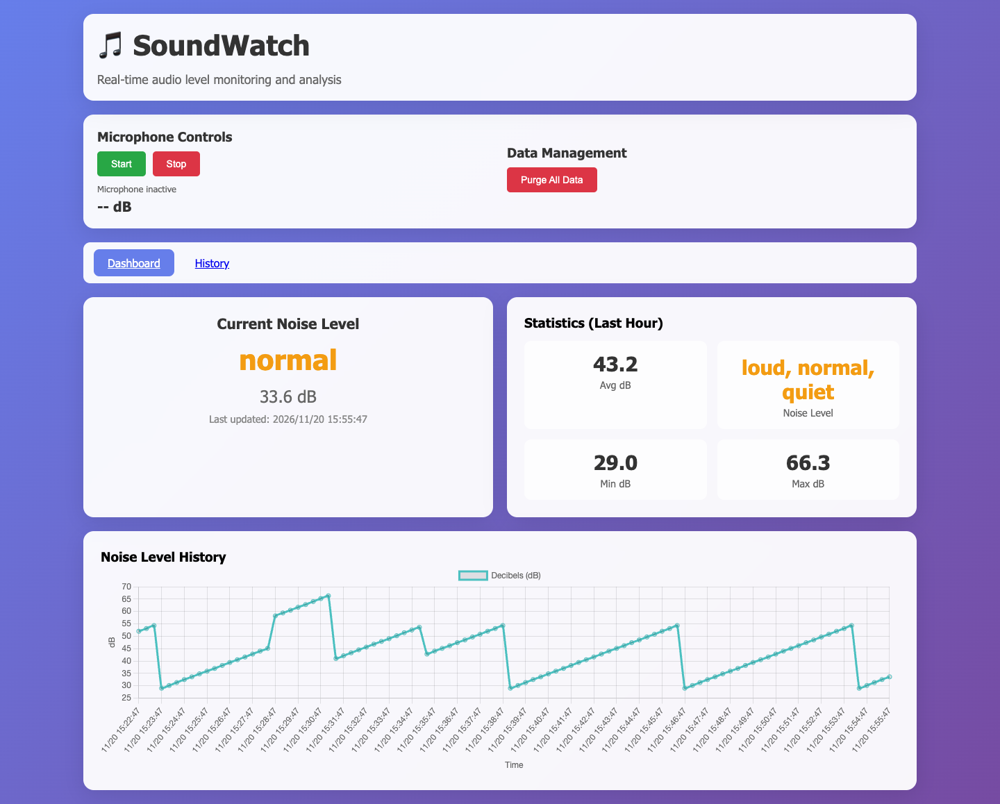
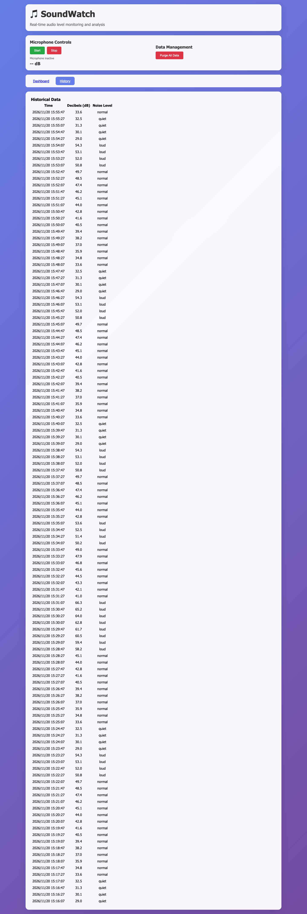
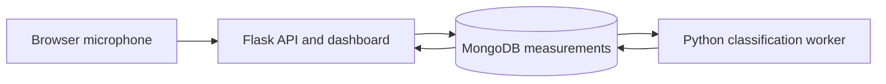

# SoundWatch — Ambient Audio Monitoring

**A three-service application for microphone sampling, five-level loudness classification and a live/history dashboard.**


[](https://github.com/swe-students-fall2025/4-containers-primebyte/actions/workflows/ml-client-tests.yml)
[](https://github.com/swe-students-fall2025/4-containers-primebyte/actions/workflows/web-app-tests.yml)

SoundWatch collects browser-microphone readings, stores them in MongoDB and labels them **silent / quiet / normal / loud / very loud**. Users inspect the latest reading and historical measurements in a Flask dashboard. A separate Python worker classifies new records.

## See the application





These screenshots show the real UI with synthetic demonstration records and an isolated in-memory MongoDB substitute. They illustrate the workflow, not a field measurement or deployed service.

## Architecture



Docker Compose runs MongoDB, Flask and the worker as separate services. The worker fits one-dimensional K-means to recent readings and maps ordered cluster centers to five labels. It falls back to fixed thresholds when there is insufficient history.

## Contribution and skills

The team built the overall system. **Yuxuan / Esther Feng** connected current-reading and history queries to real MongoDB measurements, replacing simulated responses, and worked on CI lint dependencies and environment documentation.

| Work | Ability demonstrated |
| --- | --- |
| Current and historical measurement APIs | Backend queries, data contracts and UI integration |
| Independent web and classification services | Service boundaries and shared-data workflows |
| Docker Compose configuration | Reproducible multi-service development |
| Tests and lint workflows | Debugging development and CI environments |

## Quick start

Prerequisite: Docker Desktop or Docker Engine with the Compose plugin.

```bash
git clone https://github.com/swe-students-fall2025/4-containers-primebyte.git
cd 4-containers-primebyte
cp .env.example .env
docker compose up --build
```

Open **http://localhost:5000**. If port 5000 is occupied, change only the host side of the web service port mapping in `docker-compose.yml`, then use that port in your browser.

### Choose a data source

| Mode | Configuration and action |
| --- | --- |
| Microphone | Set `USE_FAKE_DATA=false` in `.env`, restart services, allow microphone access and click **Start Microphone** on the dashboard. |
| Synthetic demo | Set `USE_FAKE_DATA=true` in `.env` and restart services; the worker generates labeled example readings. No microphone is required. |

Use `MONGODB_URL=mongodb://mongodb:27017/noise_monitor` inside Compose. `ML_CLIENT_INTERVAL_SECONDS` controls the worker interval. In microphone mode, data appears after capture starts; an empty database is expected before that.

```bash
docker compose logs --tail=50 web-app ml-client
docker compose down
```

`docker compose down` keeps the named MongoDB volume.

## Measurement scope

The browser estimates loudness from microphone samples and applies a fixed offset and smoothing. **The displayed values are not calibrated sound-pressure-level measurements.** Device gain, microphone hardware and browser processing affect the values. The labels demonstrate the data pipeline and relative classification; this is a course prototype, not a certified sound meter.

## Test locally

From `web-app/`:

```bash
pipenv install --dev
pipenv run pytest --cov=app --cov-report=term-missing
```

From `machine-learning-client/`, use the same commands with `--cov=client`. Each service has its own GitHub Actions workflow, linked above.

## Team

[Saud Alsheddy](https://github.com/Saud-Al5) · [Jasmine Zhu](https://github.com/jasminezjr) · [Esther Feng](https://github.com/yf2685-beep) · [Pranathi Chinthalapani](https://github.com/PranathiChin) · [William Chan](https://github.com/wc2184)

NYU Software Engineering, Fall 2025. [Course instructions](instructions.md) · [License](LICENSE)
